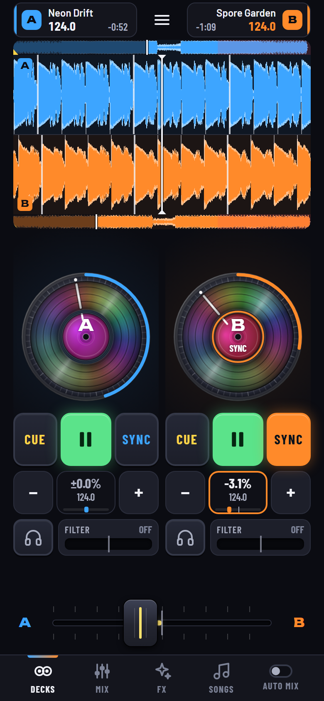
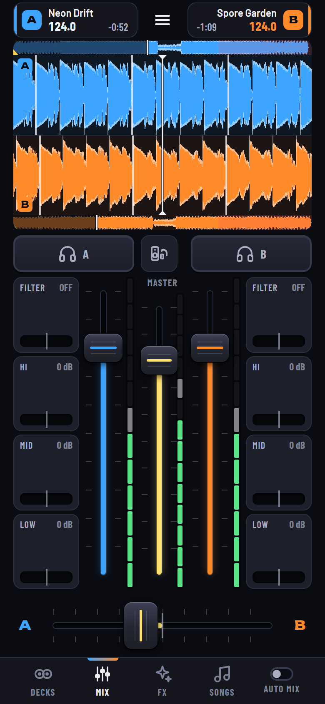
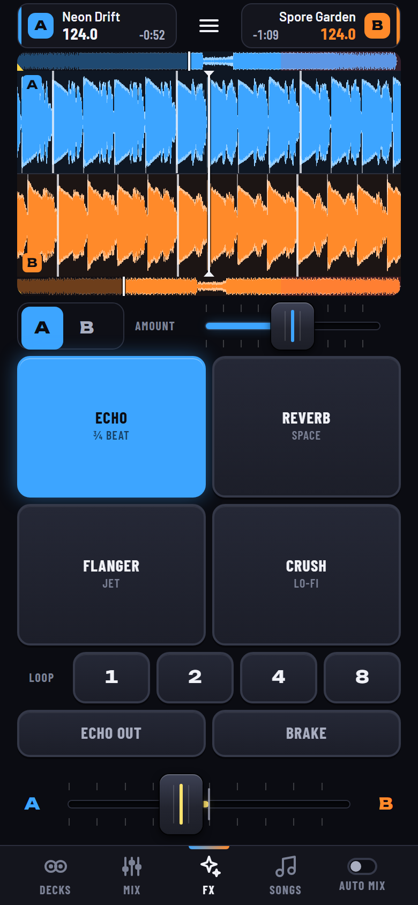
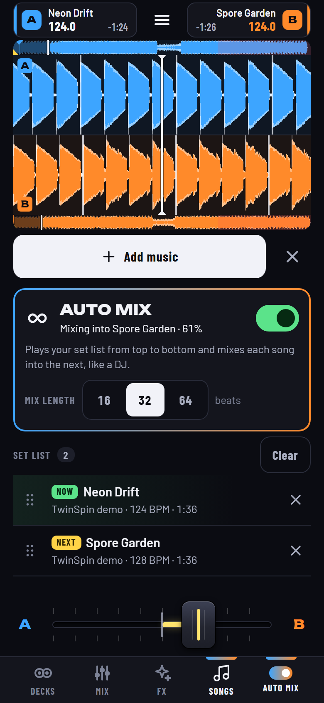
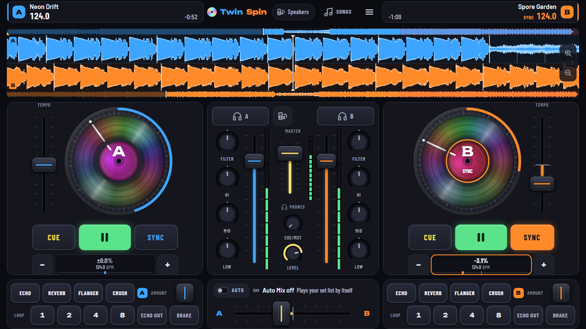

# TwinSpin

**Two decks in your pocket.** TwinSpin is a two-deck DJ app that runs in the web browser of a phone, a tablet or a
computer. Load your own songs, sync the beats, scratch the spinning records, throw in an effect and slide the
crossfader, or build a set list and let Auto Mix play it for you, one beat-matched transition after another.

<p align="center">
  
  
  
  
</p>



No install, no account, no upload: it is a web page. Two demo tracks are built in, so you can try everything
before loading your own music.

## Features

* **Two spinning record decks** you can scratch, with PLAY, CUE (CDJ style) and one-tap **SYNC** (tempo and beat)
* **Your own music**: MP3, M4A/AAC, WAV, FLAC and more, straight from the device. Nothing is uploaded.
* **Automatic BPM detection** with beat maps that follow songs whose tempo drifts, scrolling beat-marked
  waveforms, whole-song overview strips, tempo field with nudge buttons
* **Mixer**: channel volume, 3-band EQ with kill, filter, crossfader (smooth or scratch cut), master volume, meters
* **Effects**: echo, reverb, flanger, bit crush, beat loops (1, 2, 4, 8 beats), echo out and vinyl brake
* **Set list + Auto Mix**: queue up songs and TwinSpin mixes each one into the next like a DJ:
  * beat-matched transitions that start on a bar, preferably on a phrase
  * when the tempos differ, the songs **meet in the middle**: the current song drifts toward the next one's
    tempo before the mix
  * a **bass swap** half way through, so the two bass lines never clash
  * afterwards the new song **eases back** to its own tempo
  * MIX NOW, 16 / 32 / 64-beat transitions, and you can take over at any moment
* **Music player page**: the set list is the queue. Play / pause, previous, next, shuffle, repeat (off / all / one),
  a seek bar, Up next (drag to reorder, tap to play now), History, master volume, and the choice of transition:
  **DJ mix**, **Crossfade** (2 to 12 s) or **Gapless**. Play now / Play next / Add to queue from the Songs page;
  lock screen and headset controls where the browser offers them
* **Headphone pre-listen** (cue) on a second output: speaker + headphones on a computer, a split cable or a
  second device on a phone (see [Outputs](#outputs-speaker-and-headphones))
* **Made for thumbs first**: big controls on a small phone, both decks side by side when you turn it sideways,
  everything on one screen on tablets and computers; keyboard shortcuts on a computer
* **Installs to the home screen** and works offline once installed

## Quick start

**Try it online:** https://ranama.github.io/twinspin/ (once GitHub Pages is switched on for this
repository, see [Deploying](#deploying)). Open it and tap **Try the demo tracks**.

**Run it on your computer** (Windows, nothing to install). In a terminal in the TwinSpin folder:

```powershell
powershell -ExecutionPolicy Bypass -File tools\serve.ps1 -Open
```

That serves the app at http://localhost:8100 (`-Port 8200` for another port; `Ctrl+C` stops it). Tap **Tap to
start** or **Try the demo tracks**. On a Mac or Linux any static web server works, for example
`python3 -m http.server 8100` in the TwinSpin folder.

Opening `index.html` straight from the disk (a `file://` address) does not work, because browsers do not run the
app's modules from there. Always go through a web address.

## On a phone or tablet

Phones only switch on the full audio engine, offline mode and "keep the screen awake" on secure **https** pages.
So do not open `http://192.168.x.x:8100` (your computer's network address) on the phone: the app loads, but with
a weaker audio engine and fewer features. Use one of these instead:

* **The GitHub Pages link** (https://ranama.github.io/twinspin/). Permanent, free, and the
  easiest way.
* **A temporary link from your PC:** double-click `tools\phone-link.cmd`. It starts the local server and a free
  Cloudflare quick tunnel and prints an `https://….trycloudflare.com/` link with a **QR code** (the link is also
  on your clipboard). It works from anywhere while the window stays open. It needs `cloudflared`
  (`winget install --id Cloudflare.cloudflared`; the script tells you if it is missing). Every run is a new link,
  and to the phone each link is a new website with an empty song list. `tools\phone-link.cmd -Qr <link>` only
  prints a QR code for any link.
* **Android over USB, no tunnel:** connect the phone, open `chrome://inspect` in Chrome on the PC, click **Port
  forwarding**, add `8100` -> `localhost:8100`, then open `http://localhost:8100` in Chrome on the phone. That
  counts as a secure address.

### Install it on the home screen

Installing gives you a full-screen app with its own icon, keeps your songs (Safari clears the data of websites
you have not opened for a week, but not of installed apps) and lets TwinSpin start without internet.

* **iPhone / iPad:** open the link in Safari, tap **Share -> Add to Home Screen**. Build your song list in the
  installed app: songs added in a Safari tab may not show up there.
* **Android:** open the link in Chrome, tap the menu **-> Install app** (or **Add to Home screen**).
* **Computer:** Chrome and Edge show an install button in the address bar.

When a new version is published, the installed app shows **Update ready**; tap it when you are not playing.

## Controls

Sliders never jump to your finger: grab them anywhere and move. Double-tap any slider to reset it; hold it still
for a moment for fine control.

**Phone, upright:** the top bar shows both songs (deck A blue on the left, deck B orange on the right), then the
waveforms, one page at a time, the crossfader and the tabs **DECKS / MIX / FX / SONGS / PLAYER**.
**Phone sideways:** deck A left, deck B right, waveforms and mixer in the middle. **Tablets and computers** show
everything at once.

| Control | What it does |
|---|---|
| **Record** | Tap an empty one to load a song. Touch it and move your finger round to scratch; let go and it plays on. (With **Scratch on the record** off in Settings, it nudges the tempo instead.) The ring shows progress and blinks red in the last 30 seconds. |
| **PLAY** | Start / pause. |
| **CUE** | Paused: marks a starting point. Playing: jumps back to it and stops. Hold it on the point to preview; let go to jump back. |
| **SYNC** | Matches this deck's tempo and beat to the other deck and keeps following it. Hold to reset the tempo. |
| **Tempo field** | Drag sideways to speed up or slow down (shows % and BPM). **-** / **+** push the beat back or ahead while held. |
| **Waveforms** | Beat ticks of both decks meet in the middle when they are in sync. Pinch to zoom. Drag a paused deck's waveform to find a spot. The thin strip is the whole song: tap to jump (hold, while the deck is on air). |
| **MIX page** | Headphone buttons (pre-listen), FILTER, HI / MID / LOW (all the way down = kill), deck volumes, MASTER. |
| **Crossfader** | Blends from deck A (left) to deck B (right). Smooth or Cut curve (for scratching) in Settings. |
| **FX page** | Pick deck A or B, then ECHO, REVERB, FLANGER, CRUSH (tap = on/off, hold = only while held), AMOUNT, LOOP 1 / 2 / 4 / 8, ECHO OUT, BRAKE. |
| **SONGS page** | **+ Add music**, Auto Mix and the set list, your songs with big **A** / **B** load buttons, **+** (add to the set list = the queue) and **⋯** (Play now, Play next, Add to queue, Remove), the demo tracks. |
| **PLAYER page** | The queue as a music player: the song now playing (its record spins), seek bar, shuffle / previous / play / next / repeat, AUTO MIX switch, transition (DJ mix, Crossfade, Gapless), volume, Up next (drag the handle, x removes, tap plays it now), History, Clear queue. On a computer it opens from the header, sideways on a phone from the PLAYER button over the waveforms. On the DECKS page the strip shows what comes next with previous / play-pause / next; tap it to open the player. |
| **Menu** | Outputs, Songs, the music player, Settings and Help. |

**Keyboard (computer):** deck A `Q` play, `W` cue, `E` sync, `1 2 3 4` loops of 1, 2, 4, 8 beats; deck B `P` play,
`O` cue, `I` sync, `7 8 9 0` loops; `<-` `->` crossfader (`Shift` for small steps); `M` Auto Mix on / off; `Esc`
closes a panel; music player: `Space` play / pause (while the player is open), `N` next song, `B` previous song. You
can also drop audio files on a deck.

**A first mix:** load a song on deck A and press PLAY. Load another on deck B, press SYNC on deck B, press PLAY
on B, then slide the crossfader from A to B.

## Auto Mix

Auto Mix plays your set list from top to bottom and mixes each song into the next, like a DJ.

1. **Build a set list** on the SONGS page: tap **+** on any song (or **Add all**). Songs you add with **+ Add
   music** go to the end of the list too. Drag a row's handle to change the order. A song can be on the list
   more than once.
2. **Switch on AUTO MIX** (on the SONGS page, on the PLAYER page or its big play button, in the tablet tab bar, or
   press `M`). If nothing is playing, the song the player shows as ready starts on deck A (the top of a new list);
   if a song is already playing, Auto Mix carries on from there.
3. The next song is prepared on the other deck, and a countdown shows when the mix starts. **MIX NOW** starts it
   at the next bar.

How a transition works:

* Mix-out and mix-in points are picked from the music: it skips silent intros and fade-out tails and starts on a
  bar, on a 16-beat phrase when one is close.
* Tempos within about 4 % are simply matched. Between about 4 % and 20 % apart, the playing song first glides
  half way toward the next song's tempo and the two meet there. Further apart (or without a BPM), Auto Mix does a
  short, echo-style blend instead of a beat-matched one.
* The crossfader follows an equal-power curve over 16, 32 or 64 beats. Half way through, the bass moves from the
  old song to the new one (bass swap); the EQ knobs show it happening.
* After the mix, the new song eases back to its own tempo, about 1 % per 8 beats.
* At the end of the list the last song plays out and Auto Mix switches off (with repeat on in the player, the list
  starts over, or the song plays again).
* The PLAYER page can also move between songs with a plain crossfade or gapless instead of a DJ mix.

Mix length, ease back and bass swap are in **Menu -> Settings**. Touch the crossfader or a control of a deck
that is being mixed and Auto Mix hands the mix over to you ("You took over the mix"); switch it on again whenever
you like. Auto Mix always starts switched off after a reload, so music never starts by itself.

## Outputs: speaker and headphones

A DJ listens to the next song in headphones (pre-listen, "cue") while the crowd hears the main mix. That needs
two separate outputs, and what a browser allows depends on the device. Open **Menu -> Outputs** to choose.

| Device | What works |
|---|---|
| **Phone or tablet (Android, iPhone, iPad)** | A web page gets **one** audio output. That is a limit of Android and iOS, not of TwinSpin: a Bluetooth speaker plus Bluetooth headphones at the same time is not possible (Samsung Dual Audio and similar features only copy the same sound to both). Your choices: **One output** (everything to the phone or whatever is connected; the headphone buttons only light the meters), **Split cable**, or **Second device**. |
| **Computer** (Chrome, Edge, Firefox; Safari 18.4 or later on a Mac) | **Speaker + headphones**: the mix to one output and your headphone mix to another, for example the laptop's headphone socket and a USB or Bluetooth speaker. Tap **Find devices** once: the browser asks for microphone permission only to show the device names (nothing is recorded; Firefox asks you to pick each device instead, Safari asks again after each reload). **Test** plays a sound so you know which is which. Split cable and Second device work here too. |

**Split cable** (any device with a headphone socket or a USB-C audio adapter): the main mix plays in mono on one
side and your headphone mix on the other. Plug a "stereo to dual mono" Y-splitter cable into the socket, one plug
to the speaker's AUX input and one to your headphones (**Swap sides** if they are the wrong way round). Turn off
**Mono audio** and Dolby / spatial sound effects in the phone's settings, or the two sides mix. Does not work
over Bluetooth.

**Second device** (needs internet for the hand-shake): a second phone or a laptop plays your headphone mix (or the
main mix, your choice). Open **Outputs -> Second device**, scan the code with the other device and tap **Tap to
listen** there. Both devices should be on the same Wi-Fi or a phone hotspot; guest Wi-Fi may block it. The second
device runs about half a second behind, so let **SYNC** do the beat-matching.

**Bluetooth is slow.** Bluetooth speakers and headphones each add roughly 0.1 to 0.3 seconds of delay, and two
devices are rarely delayed by the same amount. Scratching over Bluetooth feels late; use wired headphones or a
wired speaker when you can. With **Speaker + headphones**, move **Output alignment** until the beats in the
headphones line up with the speaker.

## Which song files work

TwinSpin plays files that are on the device. Songs from Apple Music, Spotify and other streaming apps are
protected and cannot be loaded; buy or export DRM-free files instead.

| Format | Android, Chrome, Edge | Firefox | iPhone, iPad, Safari |
|---|---|---|---|
| MP3 | yes | yes | yes |
| M4A / AAC / MP4 audio | yes | yes | yes |
| WAV | yes | yes | yes |
| FLAC | yes | yes | yes |
| OGG (Vorbis), Opus, WebM audio | yes | yes | recent versions only |
| AIFF, CAF, Apple Lossless (ALAC) | usually not | no | yes |

If a file does not load, convert it to MP3 or M4A. On iPhone, songs need to be in the **Files** app (On My
iPhone, iCloud Drive or Downloads). Very long files (over about 15 minutes) use a lot of memory on phones.

## Troubleshooting

| Problem | Fix |
|---|---|
| **No sound on iPhone / iPad** | Tap **Tap to start** first. If the banner says **Tap to resume audio**, tap it. Still silent: **Settings -> Restart audio**. On iOS older than 16.4, flip the ring/silent switch to ring. Check the deck volume, the crossfader position and MASTER. |
| **Sound stopped after a call, Siri or the lock screen** | Tap **Tap to resume audio**, or **Restart audio** (your songs, cue points and settings come back). |
| **Features are missing or audio crackles** on a phone opened at `http://192.168...` | That address is not secure, so the browser turns off the fast audio engine, offline mode and wake lock. Use an https link (GitHub Pages or `tools\phone-link.cmd`) or USB forwarding (Android). |
| **"Port 8100 is in use"** | TwinSpin is probably already running in another window. Close it, or use `-Port 8101`. |
| **phone-link shows no link** | Check the internet connection; some company networks block Cloudflare tunnels. Try again, or use GitHub Pages. |
| **The phone cannot connect to the link** | Wait a few seconds and reload: a fresh tunnel can take a moment. Check that the phone-link window is still open. |
| **My songs are gone** | Each phone-link run is a new website with its own song list. Safari also clears websites you have not used for a week: install TwinSpin to the home screen and add your songs there. |
| **Auto Mix will not switch on** | It needs songs in the set list (SONGS page, **+** on a song) and running audio (**Tap to start**). |
| **A published update does not show up** | GitHub Pages can take a few minutes. Installed apps show **Update ready**; tap it. |
| **The screen turns off while mixing** | Settings -> **Keep the screen on**. Some phones still dim in battery-saver mode. |
| **Second device does not connect** | Both devices on the same Wi-Fi or hotspot (guest networks often block device-to-device traffic), and both need internet for the hand-shake. |

**Menu -> Settings -> About** shows the version and a diagnostics list (audio engine, output selection, secure
context), which helps when a phone behaves differently from the computer.

## Privacy

Your songs never leave your device. TwinSpin reads the files you pick in the browser and keeps your song list in
the browser's own storage on that device. There are no accounts, no analytics and no server of ours: the website
is just static files. What does go over the network:

* the app's own files from wherever it is hosted, and its fonts from Google Fonts;
* only in **Second device** mode: the PeerJS library from a public CDN, the free public PeerJS server and
  Google's public STUN servers for the hand-shake, and a QR code library. The audio itself then goes directly
  from one device to the other.

## Development

TwinSpin is plain HTML, CSS and JavaScript ES modules: no build step, no npm, no framework. Edit a file, reload
the page.

```
index.html, config.js        page shell; config.js = optional deployment settings (PeerJS server, ICE servers)
manifest.webmanifest, sw.js  install metadata and the offline service worker
css/                         app.css (layout), widgets.css (controls), remote.css (second-device page)
src/main.js                  boot: the DJ app (src/ui/boot-app.js) or the second-device listener page
src/core/                    emitter, settings, feature detection, small helpers
src/audio/                   engine, deck DSP (AudioWorklet + fallbacks), mixer, effects, outputs, decoding, demo tracks
src/analysis/                BPM, beat maps, waveforms, loudness (in a worker)
src/deck/                    deck controller, CDJ cue logic, sync, set list, Auto Mix
src/library/                 the song list (IndexedDB)
src/remote/                  second device over WebRTC (PeerJS, loaded only when used)
src/ui/                      app UI, pages and sheets; src/ui/widgets/ = records, faders, knobs, waveforms
icons/                       app icons (made by tools/make-icons.ps1)
tests/                       *.test.js for JsCheck; tests/helpers/ = fake DOM and models
tools/                       serve, phone-link, publish-web, make-icons, JsCheck
docs/                        CONTRACT.md, AUTOMIX.md, CHANGES.md, DEPLOY.md, research notes, screenshots
.github/workflows/           ci.yml (check + test every push), pages.yml (test + deploy to GitHub Pages from main)
```

### Checks and tests

The bundled **JsCheck** (a small .NET tool around the Jint JavaScript interpreter, so no Node is needed) checks
and tests the code. It needs the [.NET 10 SDK](https://dotnet.microsoft.com/download); the first run builds it.

```bash
tools/JsCheck/jscheck check src tests          # syntax, imports, exports, undeclared names
tools/JsCheck/jscheck test tests               # every tests/*.test.js
tools/JsCheck/jscheck run tests/pwa.test.js    # one file
```

In PowerShell use `tools\JsCheck\jscheck.ps1` with the same arguments. CI runs the check with `--strict`, so
warnings fail too: keep it at 0 errors and 0 warnings. Pure logic (DSP, BPM detection, cue and
sync maths, Auto Mix planning, routing plans) lives in modules without DOM or Web Audio, so it is tested
headlessly; the UI tests use a small fake DOM.

`tests/realsongs.test.js` is an optional regression set on real music: put your own WAV files in `tests/media/`
(gitignored, never committed). When they are missing those tests are skipped, so a fresh clone passes without
them.

### Design documents

* [docs/CONTRACT.md](docs/CONTRACT.md): the rules every module follows (APIs, units, behaviour, file ownership)
* [docs/AUTOMIX.md](docs/AUTOMIX.md): the set list and Auto Mix design
* [docs/CHANGES.md](docs/CHANGES.md): changes and deviations from the contract, one bullet each
* `docs/research/`: the research notes behind the design (audio output routing, engine, BPM, PWA, WebRTC, UX)

### Deploying

Step by step, from an empty GitHub repository to a live app: [docs/DEPLOY.md](docs/DEPLOY.md).

**GitHub Actions (recommended).** `.github/workflows/pages.yml` runs on every push to `main` that changes the app:
it runs the tests, builds the site with `tools/publish-web.ps1 -Ci` and deploys it to GitHub Pages. Pushes that
only touch documentation or tests do not publish a new version; **Actions -> Deploy to GitHub Pages -> Run
workflow** publishes by hand. Switch it on once in the repository: **Settings -> Pages -> Build and deployment ->
Source: GitHub Actions** (until then the deploy step fails with "Get Pages site failed"; run it again afterwards).
The app then lives at https://ranama.github.io/twinspin/. A second workflow,
`.github/workflows/ci.yml`, checks and tests every push and pull request.

**Manual alternative.** `tools\publish-web.ps1` builds the same site on your PC and pushes it to the `gh-pages`
branch of your repository (Git Credential Manager asks you to sign in to GitHub in your browser the first time;
the script never sees a password):

```powershell
powershell -ExecutionPolicy Bypass -File tools\publish-web.ps1 -Repo https://github.com/Ranama/twinspin.git -Open
```

For this route set **Settings -> Pages -> Source: Deploy from a branch -> gh-pages / (root)** instead. Use one
route or the other, not both. `tools\publish-web.ps1 -Zip -Open` makes `site.zip` for Netlify Drop or any other
static host.

Both routes build `site\` with only the runtime files, stamp a new service worker `VERSION` and write the exact
offline file list into `site\sw.js`, so installed apps see **Update ready**.

### Tools

| Script | What it does |
|---|---|
| `tools\serve.ps1 [-Port 8100] [-Root site] [-Open] [-Log]` | Local web server with the right file types and no caching. Hidden files (`.git`) are never served. |
| `tools\phone-link.cmd [-Port 8100] [-NoQr] [-Qr LINK]` | Local server + Cloudflare quick tunnel: an https link and QR code for a phone. |
| `tools\publish-web.ps1 [-Zip] [-Repo URL] [-Open] [-NoPush] [-SkipCheck] [-Ci]` | Builds `site\`, stamps the service worker, checks it, then zips it or pushes it to GitHub Pages. `-Ci` is the non-interactive build the workflow runs. |
| `tools\make-icons.ps1` | Renders the app icons (PNG and SVG) into `icons\`. |

### Notes

* **Service worker.** `sw.js` is registered only on https hosts: never on `localhost`, and `?nosw` in the
  address unregisters it (handy when testing on a phone). Pages, scripts and styles load network-first (with a
  3-second fallback to the offline copy), icons and fonts cache-first. The copy in the repository has
  `VERSION = 'twinspin-dev'` and a hand-kept file list between `// @shell-begin` and `// @shell-end`: if you add
  a module, add it there too (the published build writes the list by itself). A new version waits until the
  user taps **Update ready**.
* **Screenshots.** `?shot=decks` (or `mix`, `fx`, `songs`, `desktop`, `start`) opens a ready-made demo scene for
  the pictures in `docs/screenshots/`: both demo tracks playing in sync, the requested page, no tips, and its own
  settings so yours are left alone. It starts audio without a tap, so use a browser that allows autoplay (for
  example Edge or Chrome started with `--autoplay-policy=no-user-gesture-required`) with a 390 x 844 phone
  viewport, or 1366 x 768 for `desktop`.
* `window.twinspin` in the browser console gives you the running app (settings, engine, decks, sync, set list,
  Auto Mix, UI).

## Browser support

TwinSpin needs a recent browser with Web Audio and JavaScript modules. If yours is too old, it says so and asks
you to update instead of showing a blank page.

| Browser | Plays and mixes | Speaker + headphones | Install |
|---|---|---|---|
| Chrome, Edge (Windows, macOS, Linux, ChromeOS) | yes | yes | yes |
| Firefox (desktop) | yes | yes (you pick each output) | no |
| Safari on a Mac | yes | Safari 18.4 or later | Add to Dock |
| Chrome on Android | yes | one output: split cable or second device | yes |
| Safari on iPhone and iPad | yes | one output: split cable or second device | Add to Home Screen |

Other browsers built on Chrome may work as well but are not tested. On a phone, open TwinSpin over https (see
[On a phone or tablet](#on-a-phone-or-tablet)).

## Credits

* [PeerJS](https://peerjs.com/) 1.5.5 (MIT), loaded from a CDN only when you use **Second device**, and the
  free public PeerJS server for the hand-shake.
* [qrcode-generator](https://github.com/kazuhikoarase/qrcode-generator) 1.4.4 by Kazuhiko Arase (MIT), loaded
  from a CDN for the Second device QR code.
* Fonts: [Barlow, Barlow Condensed](https://fonts.google.com/specimen/Barlow) and
  [Unbounded](https://fonts.google.com/specimen/Unbounded) from Google Fonts (SIL Open Font License).
* JsCheck is built on [Jint](https://github.com/sebastienros/jint) and
  [Acornima](https://github.com/adams85/acornima).
* Everything else, including the audio engine, BPM detection and the two demo tracks (synthesised in the browser),
  is written for TwinSpin.

## License

No license chosen yet. Until one is added, the code is publicly visible but all rights are reserved: please ask
before reusing it.
